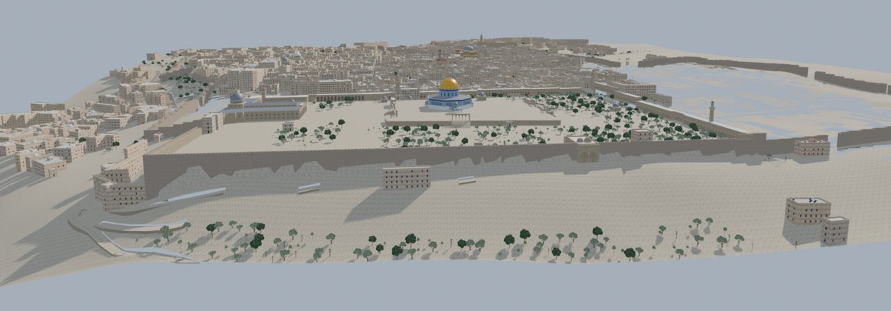
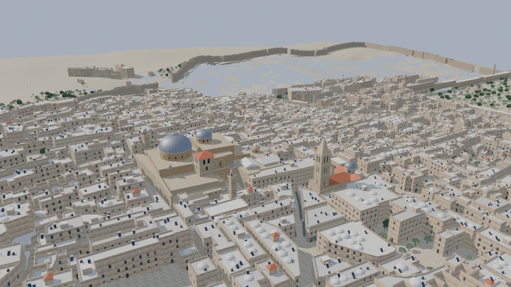
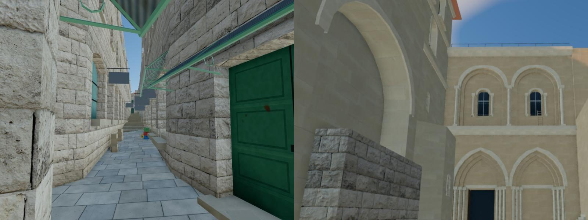
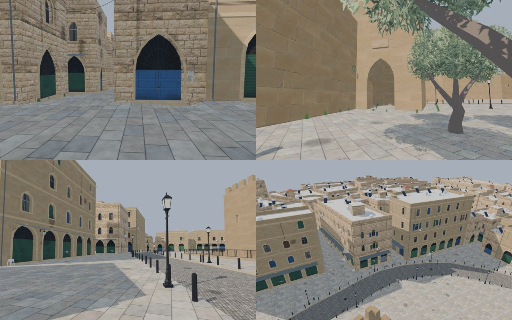
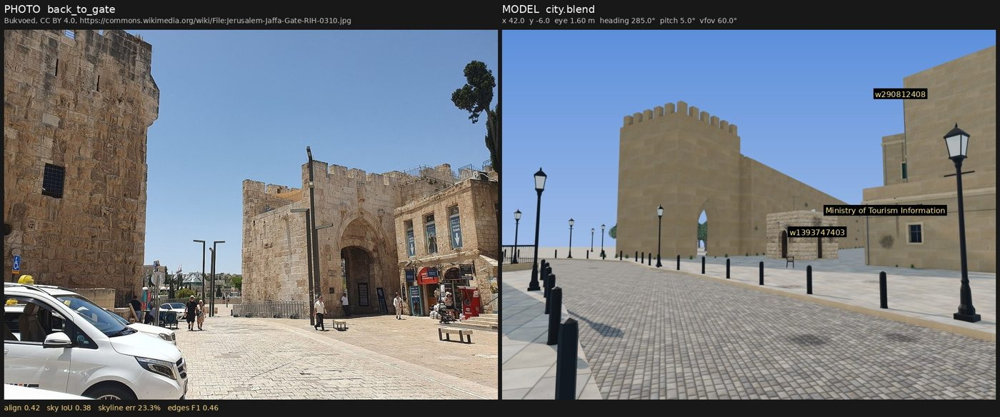
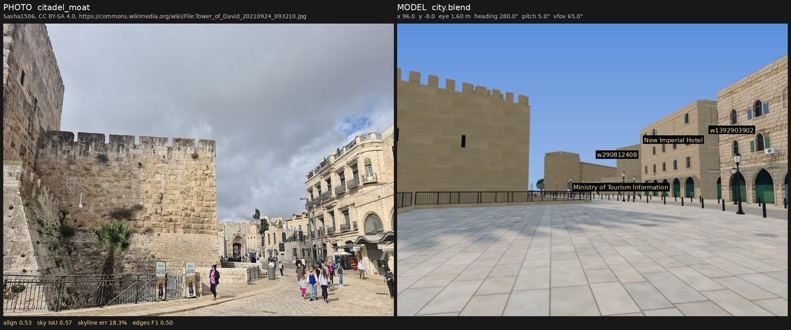
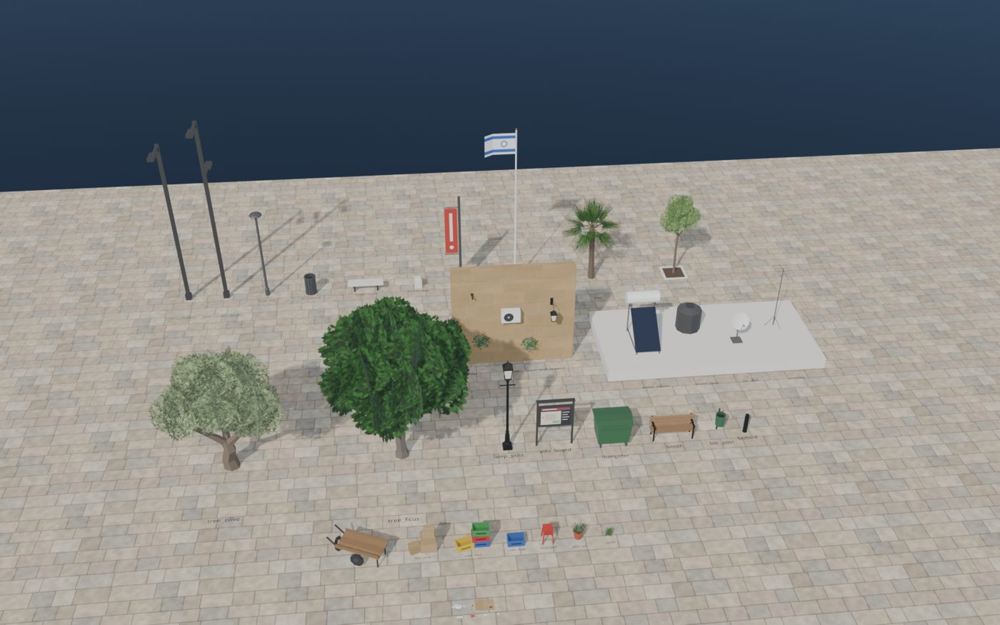
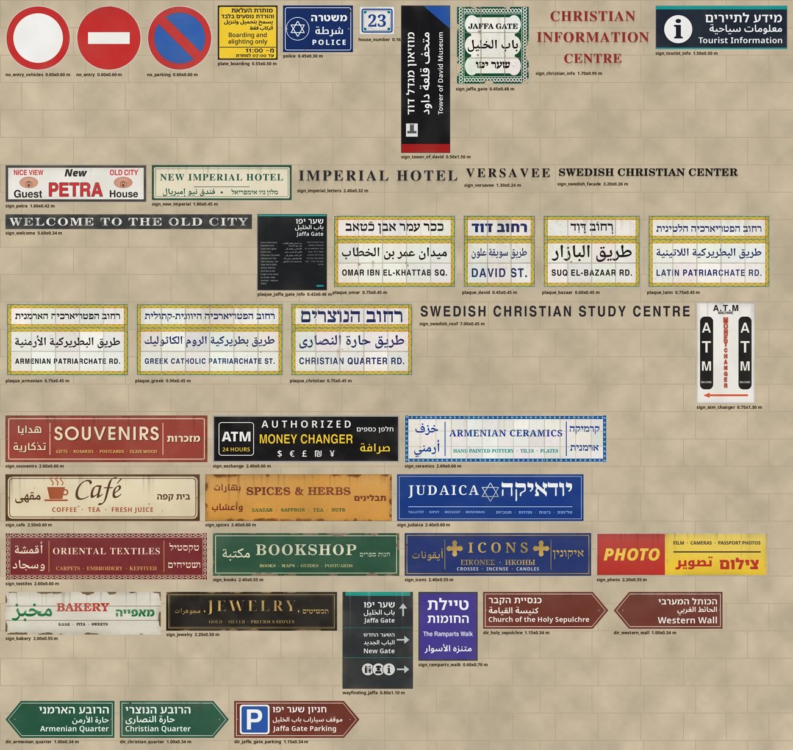

# Old City Walker

A walkable, geo-registered recreation of Jerusalem's walled Old City, built from open data: an
example of what an AI coding agent can build for a real place. Buildings come from
OpenStreetMap footprints, street levels from an 1865 survey, and heights, facades and detail from
photo-based research. Each place is checked against real photographs and Street View. The city is
modelled in Blender and walked in a browser (three.js). Every point in the game maps to a real
lat/lon. Shops are closed and there are no people.

**Walk it in the browser: <https://old-city-walker-claude.yuranu.com>** (desktop or phone; the
city streams in, ~180 MB).

The project was developed with [Claude Code](https://claude.com/claude-code): the pipeline, the
Blender builders, the game and the QA loop were written by Claude under the author's direction.



* **The whole walled city**, streamed by sector: 2,600 buildings, 0.86 km², 35 m of fall from
  Jaffa Gate to the Western Wall plaza. Market streets have closed shopfronts and canopies,
  covered souqs and passages are vaulted, and steep lanes are stepped. Domed roofscapes, gates
  and the wall circuit are built, along with the landmarks: the Holy Sepulchre, the Temple Mount,
  the Redeemer, the Hurva, minarets and churches.
* **The Jaffa Gate area** (the first, hero area): photo-matched facades, signage, fortifications.





## Three ways in

| You want to | Do this |
|---|---|
| walk the city | open the [live site](https://old-city-walker-claude.yuranu.com) |
| run it offline | download the archive from the [latest release](https://github.com/yuranu/old-city-walker-claude/releases/latest) and follow its [instructions](release/README.md) |
| rebuild it, change it, or apply the method elsewhere | build from source: [docs/BUILD.md](docs/BUILD.md) |

Controls: click to walk, **WASD** + mouse, **Shift** run, **Space** jump. **P** shows the nearest
real geotagged photo (Wikimedia Commons, with author and licence) and **N** the next one. **G**
opens the same spot and heading in Google Maps Street View. **O** toggles ambient occlusion and
**F3** shows performance. On a phone: drag to look, the on-screen stick to walk.

## What this repository is

The repository holds what is needed to rebuild the city and to see how it was made: the code,
the method, and the research notes the model depends on. It is one product of a wider research
effort, not the whole of it. It does not hold the result itself.

- **Versioned:** code (`pipeline/`, `blender/`, `game/`), the method and its documentation
  (`docs/`), the research notes and the per-building decisions (`data/reference/`), QA levels
  and findings (`data/qa/`), provenance of every photograph used (`index.json` files: source,
  author, licence, position), and snapshots of the build inputs (OSM, the 1865 survey
  transcription, terrain tiles, textures; 32 MB that never change), so the city builds offline.
- **Not versioned:** anything that can be downloaded or rebuilt. Photographs are referenced by
  URL, every snapshot and pinned photo has a checksum (`data/inputs.sha256`), and the models are
  built by `./build.sh`. The release archives and the live site carry the built city.

[docs/DATA.md](docs/DATA.md) lists every source, how it is pinned, and its licence.

## Documentation

| Document | Contents |
|---|---|
| [docs/BUILD.md](docs/BUILD.md) | requirements, fetching inputs, building, running, publishing |
| [docs/METHODOLOGY.md](docs/METHODOLOGY.md) | the method: data, tiers, spec, builders, scaling to a whole city |
| [docs/TERRAIN.md](docs/TERRAIN.md) | street-level terrain from the 1865 survey and the DEM |
| [docs/EVALUATION.md](docs/EVALUATION.md) | the photo-matched evaluation loop |
| [docs/QA.md](docs/QA.md) | QA levels, in-game captures, automated checks, vision critics, Street View references |
| [docs/DATA.md](docs/DATA.md) | data sources, what is versioned and why, licences |
| [release/README.md](release/README.md) | running a release archive |

## Repository layout

```
pipeline/            data -> scene spec (Python, shapely), textures, signs, evaluation
pipeline/qa/         QA: view planning, image and geometry checks, critic workflows, Street View pairs
blender/             builders: facades, fortifications, landmarks, props -> glTF; audits, renders
game/                Vite + three.js + three-mesh-bvh walker; game/scripts: static build, QA capture
release/             release packaging and the instructions shipped in the archive
deploy/              the live site's hosting (Cloudflare Worker config, upload script)
docs/                manuals; docs/img: figures for this README
data/raw/            input snapshots: OSM, 1865 survey transcription, terrain tiles, Poly Haven textures
data/reference/      research notes per area and landmark, overrides, profiles, evaluation cameras
data/photos*/        photo metadata (index.json); the images are fetched
data/qa/             QA levels, regions, iconic places, findings ledger, Street View panoramas
build.sh, fetch_data.sh
```

## Licence and data

The code, documentation and original renders are released under the [MIT licence](LICENSE).
Third-party data keeps its own terms: map data © OpenStreetMap contributors (ODbL), photographs
from Wikimedia Commons under their individual licences, the 1865 Ordnance Survey (public domain),
AWS Terrain Tiles, and Poly Haven textures (CC0). Details and attribution: [docs/DATA.md](docs/DATA.md).

## Findings so far

- OSM footprints, walls, gates, steps and street furniture are excellent. Heights are almost
  absent and come from photos.
- Open DEMs are useless at street scale. The ground is modelled as regions (streets, road below
  kerbs, moat, courtyard) with step runs, levelled from the 1865 survey's spot heights.
- Flicker came from coplanar geometry, mostly opening floors against the ground and overlapping
  OSM footprints. The audit drove it from 180 m² to ~1 m² of overlap.
- Commons GPS is ±5–15 m. Camera poses for evaluation are refined visually against the model.
- The photo-matched comparison is the most useful signal: it showed, for example, that the plaza
  uses modern grey lamp poles and slatted bins rather than the expected black lanterns.
- Critics that judge a view without a reference rate plausibility, not truth: a landmark passed
  review while missing its compound walls. Every critic pass now compares REAL | MODEL pairs.

| | |
|---|---|
|  |  |
|  |  |
